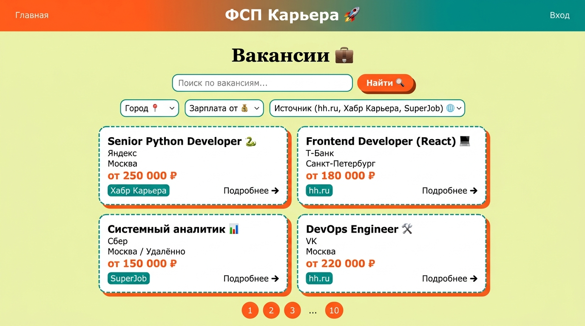
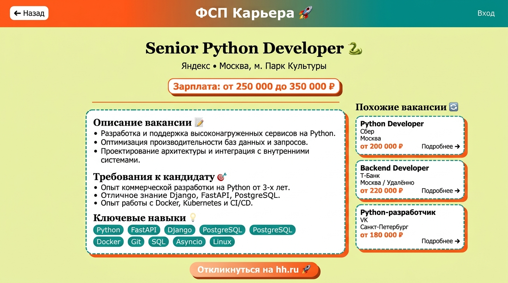
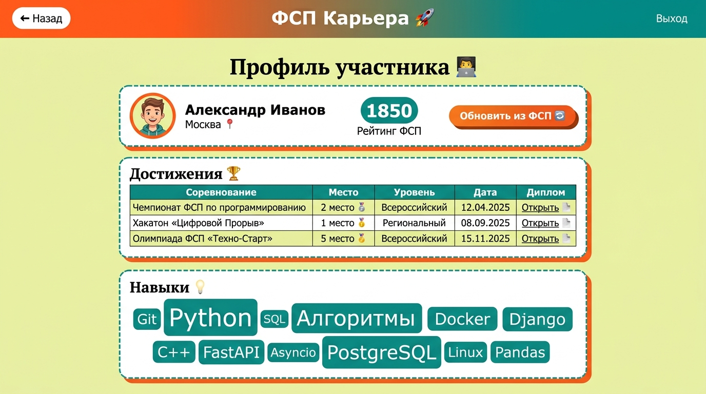
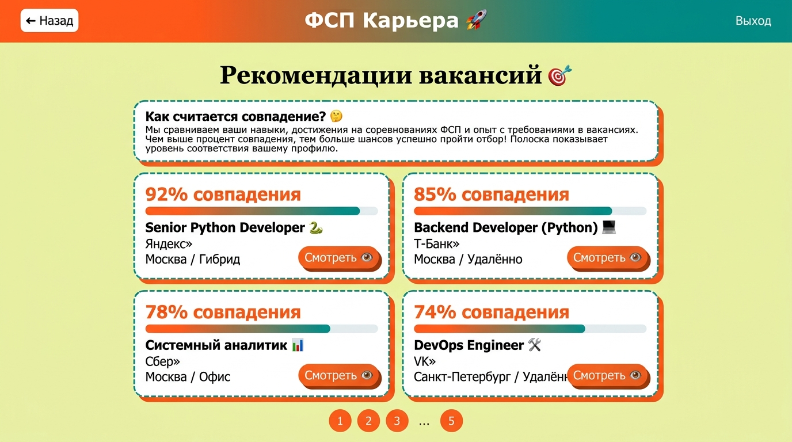
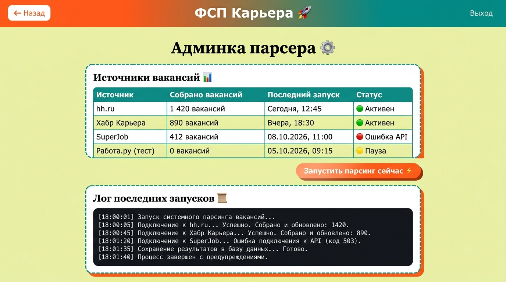

# ФСП Карьера

Цифровая платформа-агрегатор ИТ-вакансий с верифицированным профилем достижений
участника Федерации спортивного программирования (ФСП). Решение для спецтрека
ЛЦТ 2026.

## Что умеет

- собирает ИТ-вакансии с hh.ru, Хабр Карьеры и SuperJob в одну ленту;
- профиль участника с достижениями ФСП и рейтингом по Эло;
- рекомендации вакансий по навыкам и рейтингу;
- синхронизация результатов соревнований через API ФСП.

## Стек

FastAPI, SQLAlchemy, PostgreSQL 16, Celery, Redis, Vue 3, Vite, Pinia.

## Запуск

```sh
cp .env.example .env
docker compose up -d --build
```

- фронтенд: http://localhost:3000
- API и Swagger: http://localhost:8000/docs

## API

| Метод | Путь | Что делает |
| --- | --- | --- |
| GET | /api/vacancies/ | лента вакансий, фильтры `q` и `city` |
| GET | /api/vacancies/{id} | карточка вакансии |
| GET | /api/profiles/{id} | профиль участника с достижениями |
| POST | /api/profiles/{id}/sync-fsp | подтянуть результаты из ФСП и пересчитать рейтинг |
| GET | /api/matching/{user_id} | топ-20 подходящих вакансий |

Подробнее об устройстве в [docs/architecture.md](docs/architecture.md).

## Переменные окружения

| Переменная | По умолчанию | Назначение |
| --- | --- | --- |
| TH_DATABASE_URL | postgresql://talenthub:talenthub@db:5432/talenthub | подключение к PostgreSQL |
| TH_REDIS_URL | redis://redis:6379/0 | брокер Celery |
| TH_HH_API_URL | https://api.hh.ru | API hh.ru |
| TH_FSP_API_URL | https://fsp-russia.com/api | API ФСП |
| TH_PARSE_INTERVAL_MINUTES | 30 | период парсинга вакансий, минуты |

## Скриншоты

| Лента вакансий | Карточка вакансии |
| --- | --- |
|  |  |

| Профиль участника | Рекомендации |
| --- | --- |
|  |  |

Админка парсера:


